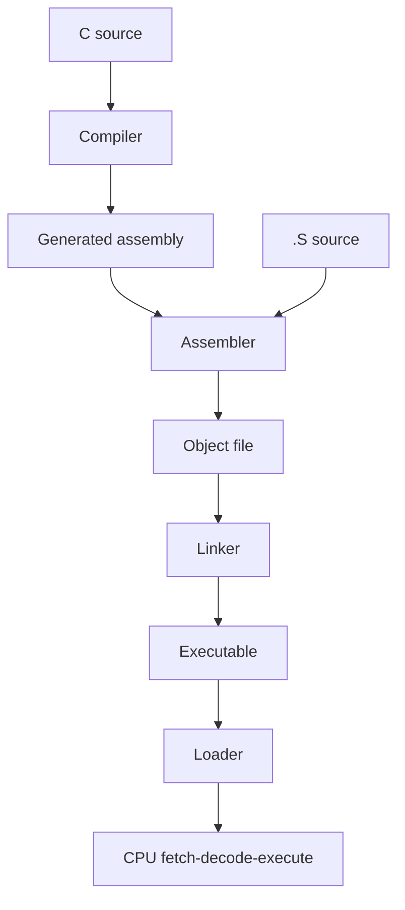

# Assembly walkthrough

The functions in `assembly/` are ordinary x86-64 machine code. C calls them. The matching C functions in `src/ref_ops.c` exist so the tests can compare results, including sums that wrap modulo 2^64. The C reference builds that wrap with `uint64_t`. It does not write a signed `+` that would overflow.

## Compilation, assembly, linking, and execution



| Stage | Who does it here | What comes out |
| --- | --- | --- |
| Compilation | GCC, for the `.c` files | Assembly for the host, then an object file. You normally do not see the generated assembly unless you ask for it |
| Assembly | GNU `as`, for `assembly/*.S` | An object file: machine code plus a symbol table. Our `.S` files skip the C compiler and are written in AT&T syntax already |
| Linking | The system linker, driven by CMake | One executable or the static library `libcs2521.a`. The linker matches `asm_add_i64` in the object file to the call in the test |
| Execution | The operating system loader, then the CPU | The loader maps the file into memory and jumps to the startup code, which calls `main`. From then on the CPU fetches the bytes the assembler produced |

`scripts/disassemble.py` runs `objdump -d` on the assembly objects and writes `docs/generated-disassembly.txt`. The left column is a section offset inside that object file. It starts at zero for each function. It is not the address the loader will choose, and the tests do not read it.

An objdump line has three useful columns: the section offset, the machine-code bytes, and the AT&T mnemonic. `ret` is the single byte `c3`. `leaq` is longer. Variable length is a property of x86, which is why the teaching CPU in `docs/cpu-cycle.md` uses a fixed slot instead.

## System V x86-64 calling convention

Integer and pointer arguments are passed in registers, then on the stack once the registers are full. The return value comes back in `%rax`.

| Register | Role for these functions |
| --- | --- |
| `%rdi` | First argument |
| `%rsi` | Second argument |
| `%rdx` | Third argument. Also the high half of `mulq` and `divq` |
| `%rcx` | Fourth argument. The loops use it as a counter because the caller does not expect it to survive |
| `%r8`, `%r9` | Fifth and sixth arguments. Unused here |
| `%rax` | Return value |
| `%rbx` | Callee-saved. `asm_factorial_u64` preserves it |
| `%rbp` | Frame pointer |
| `%rsp` | Stack pointer |

Caller-saved registers may be overwritten by the callee: `%rax`, `%rcx`, `%rdx`, `%rsi`, `%rdi`, `%r8` through `%r11`. Callee-saved registers must come back unchanged: `%rbx`, `%rbp`, `%r12` through `%r15`.

The stack is 16-byte aligned immediately before a `call`. The `call` pushes an 8-byte return address. A leaf function that does not call anything can get away with a looser alignment. The factorial prologue still builds a normal frame so the picture is visible in the source. A leaf may also use the 128-byte red zone below `%rsp` without allocating it. This lab does not. The frame is explicit.

Floating-point arguments would use `%xmm` registers. None of these functions take any.

## Stack frames

`call` pushes the return address and jumps. `ret` pops that address and jumps back. Anything else the callee puts on the stack has to be removed before `ret`, or the CPU will treat a saved register as the place to resume.

`asm_factorial_u64` builds this frame:

```text
higher addresses
    return address          pushed by call
    saved %rbp              push %rbp
    saved %rbx              push %rbx     <- %rsp after the prologue
lower addresses
```

After `push %rbp` and `movq %rsp, %rbp`, `%rbp` names this frame. `%rbx` is saved because the overflow check needs a spare callee-saved register. The epilogue pops `%rbx`, pops `%rbp`, and only then executes `ret`. The overflow path jumps to that same epilogue, so both exits are balanced.

The add, sum, and max functions are leaves that touch only caller-saved registers. They do not build a frame. `ret` is enough.

## `asm_add_i64`

```asm
asm_add_i64:
    leaq (%rdi, %rsi, 1), %rax
    ret
```

`%rdi` and `%rsi` are the two `int64_t` arguments. `leaq` writes `%rdi + %rsi * 1` into `%rax`. The sum wraps modulo 2^64, which is what a 64-bit adder does. `test_ops` compares `INT64_MAX + 1` with the C reference. Both produce `INT64_MIN` without a signed C overflow.

## `asm_sum_i64`

`%rdi` points at the first `int64_t`. `%rsi` is the count. `%rcx` is the index and `%rax` is the accumulator, cleared with `xorq` so the empty case returns 0 without loading through the pointer.

```asm
.Lsum_loop:
    cmpq %rsi, %rcx
    jae .Lsum_done
    addq (%rdi, %rcx, 8), %rax
    incq %rcx
    jmp .Lsum_loop
```

AT&T `cmpq %rsi, %rcx` compares `%rcx` with `%rsi`. `jae` leaves the loop when the index is above or equal to the count. The memory operand `(%rdi, %rcx, 8)` is address `%rdi + %rcx * 8`, one 8-byte element per index. `addq` wraps the same way the reference does.

## `asm_max_i64`

The precondition is a non-empty array. The first element is the initial maximum. `cmpq %rax, %rdx` sets the flags from a signed comparison, and `cmovg %rdx, %rax` replaces the maximum only when the new element is greater. Equal values stay put. The test covers `INT64_MIN`, ties, and a one-element array so the signed condition is doing the work.

## `asm_factorial_u64`

`%rdi` is `n` and `%rsi` points at an `int` overflow flag. The flag is required to be non-null.

`0!` and `1!` return 1 with the flag cleared. For a larger `n`, the product starts at 1 and the factor `%rcx` starts at 2. Before multiplying, the function divides `UINT64_MAX` by the factor (`movq $-1, %rax`, clear `%rdx`, `divq %rcx`). If the current product is greater than that quotient, the multiply would not fit in 64 bits: the flag becomes 1, the result becomes 0, and the function returns through the shared epilogue.

`20!` is `2432902008176640000` and fits. `21!` does not. The check fires at 21, so a call with `n = 40` still returns immediately instead of looping all the way out. `mulq %rcx` then does the actual multiply into `%rdx:%rax` only after the check has passed.
