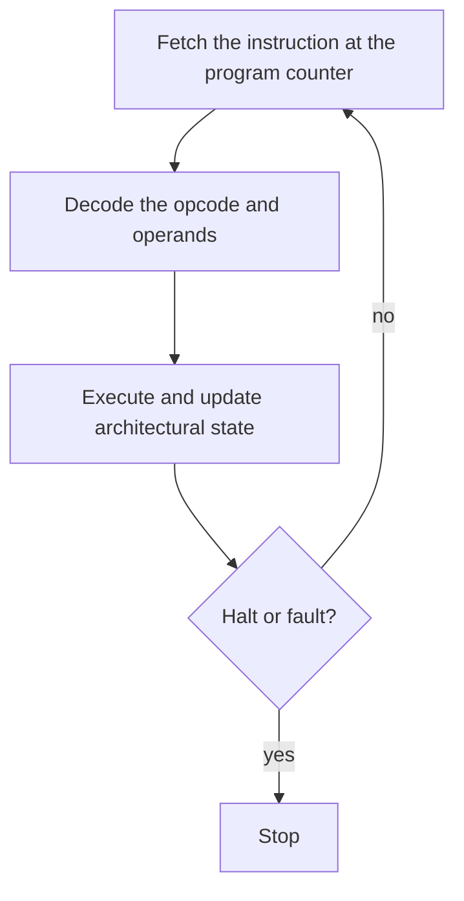

# CPU cycle

A CPU repeats a short loop until the program tells it to stop or something illegal happens. The teaching machine in `include/sim.h` makes each beat a function: `sim_fetch`, `sim_decode`, and `sim_execute`. `sim_step` runs one full cycle. `cs2521_sim_demo` prints every cycle of a countdown that sums 1 through 5.



## Registers

A register is a storage cell inside the CPU. The arithmetic unit reads and writes registers directly. It does not reach into DRAM for every operand.

The teaching CPU has three kinds of register state:

| Name | Role |
| --- | --- |
| Program counter, `pc` | Index of the next instruction in the program array |
| Instruction register, `ir` | The instruction just fetched |
| `r0` through `r7` | General-purpose 32-bit registers |

`r0` is an ordinary register. It is not hardwired to zero. A real CPU also keeps a flags register: after a subtraction, later branch instructions look at those flags. This simulator does not. `JZ` reads the named register and compares it with zero. That is a teaching shortcut, and the walkthrough of the x86 code shows real flag-setting instructions such as `cmpq`.

On the host CPU, the registers you will see in the assembly chapter have names: `%rax`, `%rdi`, `%rsp`, and the rest. Those are a different file cabinet from `r0` through `r7` here.

## Instructions and opcodes

An instruction is an operation plus its operands. The opcode is the field that says which operation. The teaching instruction is four fields and always the same size:

| Field | Width | Meaning |
| --- | --- | --- |
| `op` | 8 bits | Opcode |
| `a` | 8 bits | Primary register |
| `b` | 8 bits | Secondary register |
| `imm` | 16 bits, signed | Immediate or address, from -32768 to 32767 |

Because every instruction is one slot, fetch is an array read and the program counter counts instructions. An x86 program counter counts bytes, and x86 instructions vary in length. That is why a disassembly of `assembly/*.S` shows different byte lengths for `ret`, `leaq`, and `divq`, while every teaching instruction occupies one program slot.

| Opcode | Name | Effect |
| --- | --- | --- |
| 0 | `HALT` | Set halted. Leave `pc` on this instruction. |
| 1 | `LDI a, imm` | `regs[a] = imm`, then `pc += 1` |
| 2 | `ADD a, b` | `regs[a] += regs[b]`, then `pc += 1` |
| 3 | `SUB a, b` | `regs[a] -= regs[b]`, then `pc += 1` |
| 4 | `LOAD a, imm` | `regs[a] = mem[imm]`, then `pc += 1` |
| 5 | `STORE a, imm` | `mem[imm] = regs[a]`, then `pc += 1` |
| 6 | `JMP imm` | `pc = imm` |
| 7 | `JZ a, imm` | If `regs[a] == 0`, `pc = imm`. Otherwise `pc += 1`. |

`HALT` and `JMP` ignore the register fields. `LDI`, `LOAD`, and `STORE` ignore `b`. Addition and subtraction wrap modulo 2^32. The simulator builds that wrap with unsigned arithmetic, so the host C compiler never sees a signed overflow.

Program storage and data memory are separate. The program array holds up to 128 instructions. Data memory holds 256 words of `int32_t`. A real x86 CPU fetches instructions and loads data from one address space. Splitting them here keeps "the next instruction" from being confused with "the integer in memory."

## What one cycle does

1. **Fetch.** If the CPU is already halted or faulted, stop. If `pc` is outside the loaded program, record a program-counter fault and stop. Otherwise copy `program[pc]` into `ir` and count one cycle.
2. **Decode.** Read the opcode and operands. An unknown opcode or a register number above 7 is a fault. `pc` stays on the bad instruction.
3. **Execute.** Perform the operation. A normal instruction then sets `pc` to `pc + 1`. A taken jump sets `pc` to the immediate. A jump target outside the program is a fault, and `pc` is left unchanged.
4. **Halt.** `HALT` sets the halted flag. Further steps return immediately and do not fetch again, so the cycle counter stays still.

`cs2521_sim_demo` runs this program:

```text
LDI  r0, 0      sum
LDI  r1, 5      counter
LDI  r2, 1
ADD  r0, r1     loop: sum += counter
SUB  r1, r2     counter -= 1
JZ   r1, 7      exit when the counter hits 0
JMP  3
STORE r0, mem[0]
HALT
```

The counter visits 5, 4, 3, 2, and 1. `r0` and `mem[0]` both finish at 15.

## Faults

| Reason | Example |
| --- | --- |
| Program counter | Execute the instruction after the last one, or jump to a negative index |
| Opcode | A byte that is not 0 through 7 |
| Register | `LDI` with register 8 |
| Memory | `STORE` to address -1 or 256 |

A failed `cpu_load_program` leaves the previous CPU image alone. The limit is 128 instructions. Tests check these conditions by fault reason and register or memory value. They never look up a host address.
